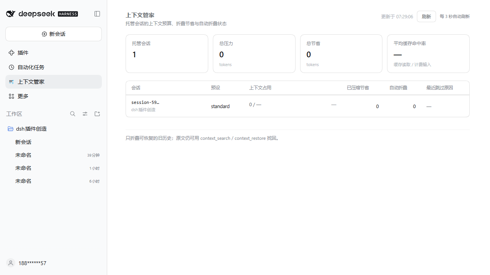

# dsh-context-keeper

**English** | [简体中文](README.md)

[](https://github.com/YansongG-HKU/dsh-context-keeper/actions/workflows/ci.yml)
[](LICENSE)

A native DeepSeek Harness (DSH) plugin that makes **long sessions genuinely cheaper** while **keeping the model sharp**.

It is not a proxy, it does not rewrite requests, and it never touches the model API. It is a Host plugin that attaches to every top-level session and works through DSH's own session log, token accounting, and compaction transaction machinery:

- **See it** — `context_status` reports the current context budget, its composition, the heaviest history entries, total savings from folds, and cache hit ratio.
- **Get it back** — `context_search` searches the **full session log**, including history that has been compacted out of the surface; `context_restore` returns the original text by seq. Folding is not deletion.
- **Fold it** — `context_compact` lets the model choose which old span to fold, with `dry_run` to preview the plan first.
- **Save automatically** — when pressure crosses a threshold, the oldest tool-call-balanced span is folded into a summary before each step, keeping the most recent 30K tokens verbatim. The native 80% compaction remains the fallback.

## Why "borrowed ideas, native plumbing"

| What billion-context does well | How this plugin absorbs it | Why that fits DSH better |
| --- | --- | --- |
| The model decides when to fold and what to fold | `context_compact` + `context_status` tools | No proxy tools to inject, no request stream to rewrite — folds go through native session transactions |
| Incremental, layered compaction (multi-generation summaries) | Each auto fold takes only the oldest span; the next fold merges the previous summary into its head | Reuses the `compaction/*` event protocol, so UI, replay, and persistence work unchanged |
| Reversible (`decompress`) | `context_search` + `context_restore` read the raw events | DSH already keeps replaced original events in the log; the plugin just exposes retrieval to the model |
| Searchable (`search_context`) | `context_search` covers visible, compacted, and summary rows | Reads the append-only log directly — no separate index or store |
| Prefix-cache friendly | The summary call replays the **same** system + tools + range messages; the folding instruction is appended at the end only | Structurally identical to stock `dsh-compaction-basic`, so the provider's hot prefix is reused |
| Usage / compaction state visible | `context_status.usage`, `.compaction` | Reads DSH's own token meter and session log instead of maintaining a second ledger |

DSH's built-in token savers are **not reinvented**: automatic compaction (`dsh-compaction-basic`), oversized tool-result pruning (`dsh-compaction-tool-result-pruner`, 8 KiB), spill-to-file (`dsh-spill-policy`), token metering (`dsh-token-meter`), and on-demand skill loading. This plugin only fills the gap: **model-initiated folding + searchable/restorable folds + earlier, incremental folding**.

## What the model sees

Four tools, fixed in the schema of every request, about **755 tokens** in total (rough estimate at 4 chars/token). Each one can be disabled in configuration.

```jsonc
{
  "tools": { "status": true, "search": true, "restore": true, "compact": true },
  "autoCompact": {
    "enabled": true,
    "minPressureRatio": 0.6,   // fold only after 60% of the context window
    "retainTokens": 30000,     // keep the most recent 30K tokens verbatim
    "minFoldTokens": 8000,     // spans smaller than this are not worth folding
    "minGrowthTokens": 20000,  // require this much growth between folds
    "maxFoldsPerTurn": 2
  },
  "includeSubagents": false,
  "promptSection": false,
  "search": { "limit": 10, "snippetChars": 240 },
  "restore": { "maxTokens": 6000 },
  "debug": false
}
```

## Configuration

Every knob is optional. Unknown keys fail loudly (so a typo in a bundle patch cannot silently disable the plugin's savings), and numeric ranges are validated — for example `minPressureRatio` must be within 0.2–0.95.

Override configuration in the profile's `cordis.patch.yml` by row id (`install_bundle` inserts the row; a patch with the same id overrides it):

```yaml
- id: dsh-context-keeper
  config:
    autoCompact:
      enabled: true
      minPressureRatio: 0.6
```

To disable auto folding entirely and keep only the tools:

```yaml
- id: dsh-context-keeper
  config:
    autoCompact: { enabled: false }
```

## Install into a DSH profile

Requirements: DSH 0.2.2-rc.1 or newer (session format v4, unchanged in 0.2.2); Node.js ≥ 22 (tests only).

```bash
git clone https://github.com/YansongG-HKU/dsh-context-keeper
```

- **Option A (recommended):** install it through DSH's plugin manager (`plugin_manager` → `install_bundle`, with this repository directory as the bundle target). The manager inserts the bundle layer into the profile's `cordis.patch.yml` — do not hand-edit the profile.
- **Option B (manual):** do what the plugin manager would do: append `"dsh-context-keeper"` to `dsh.profile.bundles` in the profile's `package.json`, create a junction/symlink from the profile's `node_modules` to this repository directory, then restart DSH.

Any configuration override then goes into a `cordis.patch.yml` row with the same `- id: dsh-context-keeper`, as shown above. For 1M-window sessions, `minPressureRatio: 0.45` is a good starting point.

After upgrading the plugin code, restart the DSH desktop process: Host JS modules are cached in-process and the Client bundle is wired at startup. Configuration-only changes are picked up through the profile patch.

## Why it does not make the model dumber

1. **The log is never deleted.** A fold writes `compaction/start → compaction/summary → user/message(replace) → compaction/end`; the original events remain in the session log, so replay, search, and restore still see them.
2. **Summaries use the official checkpoint prompt.** The same eight-section structural summary instructions and `<compacted-summary>` framing as `dsh-compaction-basic`, so the model sees the checkpoint shape it was already trained to accept.
3. **Recent history stays verbatim.** The most recent 30K tokens are kept untouched by default; work in progress is never lost.
4. **Auto folding has guardrails.** It does nothing below 60% of the window by default, requires 20K tokens of growth between folds, and folds at most twice per turn.
5. **Native 80% compaction remains the safety net.** This plugin only folds earlier and in smaller spans; the official backend keeps working at its own threshold.
6. **A summary must be smaller than what it replaces.** Before writing, the framed summary's token count is checked against the replaced span; otherwise the transaction rolls back (recorded as `compaction/end.error`).
7. **Details are always retrievable.** `context_search` → matched seq → `context_restore` reads the original text, so the model can recover a detail it needs instead of re-exploring.

## How it works

- **Session log as source of truth.** The plugin reads the append-only log through DSH's own services; a fold is a *compaction transaction*, not a mutation of history. Original events stay in the log, which is why `context_search` and `context_restore` can reach history that is no longer on the surface.
- **Compaction transaction protocol.** `compaction/start → compaction/summary → user/message(replace) → compaction/end`, with the replace marker `{op: 'replace', startSeq, endSeq}` — exactly three keys — matching the DSH 0.2.2-rc.1 **v4** session format.
- **System-head protection.** The protected system head (the `system/message` surface node — surface node 0, though its log seq is not necessarily 0, because log-only events can precede it) is never allowed inside a folded span. `assertFoldSpan()` validates `shadowedRange` / `shadowedSeqs` and the checkpoint source before the summary is written; the log must then pass the real v4 loader replay. Regression tests replay transactions through the actual v4 validator and `Session.create`.
- **Checkpoint source kind.** The replacement `user/message` uses a producer-owned `source.kind` (`compact-checkpoint`, with the compaction id). The old `kind: 'plugin'` is rejected by the v4 loader.
- **Cache-friendly replay.** The summary call replays the same system prompt, tool schemas, and range messages; the folding instruction is appended only at the end. That keeps the prefix hot, exactly like the stock compaction backend.
- **Scoped registration.** `agent.ctx.tools.register()` adds tools inside the Agent's own scope, so subagents and the global tool table stay clean. Folding prefers `ctx.compaction.compactRegion()`; when the preset's compaction service is isolated (as in stock Web/Desktop), it falls back to a transaction with the same protocol.
- **Incremental auto policy.** Before each step, if measured pressure is at or above `minPressureRatio`, growth since the plugin's last fold is at least `minGrowthTokens`, and the candidate span is at least `minFoldTokens`, the oldest tool-call-balanced span is folded and the recent `retainTokens` are kept verbatim.

### A real incident that shaped the design

An early build folded a 240-step real session and included the **system head at log seq 15** in `shadowedRange {15..639}`. The replace failed (`invalid replace surfaceOp`) and never landed, but the abandoned `compaction/summary` alone was enough to make that session permanently unloadable (`SessionFormatError: compaction cannot shadow the protected system head` — shown in the UI as "history failed to load"). The fix had two parts: a minimal log repair (narrow the abandoned summary's declared range to `{16..639}`, **without renumbering seqs or deleting events**), and write-before validation in the plugin (`assertFoldSpan()` plus a valid checkpoint source), backed by four v4 load regression tests. That incident is why the plugin validates a transaction before writing it.

## Web panel



- Sidebar entry **"Context Keeper"** plus a main panel:
  - Header: managed sessions, total pressure tokens, total tokens saved, average cache hit ratio.
  - Session table: short id, preset, context usage (pressure / window with percentage and progress bar), savings from folding, auto-fold count, last skip reason.
  - Auto-refresh every 3 seconds plus manual refresh; explicit empty and error states.
- Data comes from the Host same-origin route `GET /context-keeper/api/state` (loopback + `x-context-keeper: 1` request header + Origin check). The panel is read-only and never triggers a fold.
- `client.js` is the hand-written browser plugin artifact registering the `sidebar.panellist` and `main` slots; `lib/panel.js` is the Host route.
- Fold statistics count only **landed** transactions: a failure where the summary was written but the replacement did not land (for example on a protocol mismatch) is not reported as savings.

## Test & benchmarks

```bash
git clone https://github.com/YansongG-HKU/dsh-context-keeper
cd dsh-context-keeper
npm test                    # offline: test deps are vendored (same DSH 0.2.2-rc.1 runtime)
# replay a decoded session log through the protocol + fold transaction
node test/verify-live-log.mjs <path-to-decoded-session.jsonl>
```

Currently **48/48 tests pass**, covering configuration validation, event text/search/restore, real `Session` system head / balanced boundaries / fold spans, hiding and restoring after a real compaction, success and failure paths of all four tools, the full event protocol of the plugin's own transactions and the "summary not smaller" rollback, failed transactions excluded from savings, auto policy thresholds/growth/per-turn cap/abort, plugin wiring and subagent skipping, Web panel slot registration/data/same-origin route checks, and **4 v4 load regressions** (`test/runtime-format.test.mjs`): a transaction's log must pass the real v4 format validator and `Session.create` replay, fold spans containing the system head must be rejected before writing, the loader must actually reject a "summary shadows the system head" failure shape, and the checkpoint message source must be `compact-checkpoint`.

Measured savings (full method and tables: [`docs/benchmarks.md`](docs/benchmarks.md)):

- **One fold in a live session:** pressure 454,619 (43.4% of a 1,048,576 window); folding 489 surface nodes / 325,988 tokens took pressure from 455,577 to ≈130,000 (**-71.5%**), so every following step pays ≈326K fewer tokens.
- **Real 240-step session** (90,156,133 cumulative billed input, 99.63% cache hit): keeping 30K verbatim folded 549 nodes / 403,901 tokens, pressure 466,617 → 62,817 (**-86.5%**); keeping 100K folded 424 nodes / 334,040 tokens (**-71.6%**).
- **Multi-step policy simulation** on real billed traces: the default 0.60 threshold never triggered in a 1M window (real peaks 590K / 727K < 629K); `minPressureRatio: 0.45` saved **33.6%** on a 240-step session and **53.2%** on a 668-step session; `0.35` saved **44.5% / 72.8%**.
- **Money basis:** DeepSeek cache hits cost 1/50 of misses. Payback is under one step in token terms, but roughly **8–25 steps** in dollar terms.

That last point is the honest caveat: with the conservative default threshold, out-of-the-box savings are ≈0 on a 1M-window session — set `minPressureRatio` to 0.35–0.45 (details are still recoverable via `context_restore`) or let the model call `context_compact` when it makes sense. For a fair, sourced comparison with Anthropic, Claude Code, Cursor, OpenAI, billion-context, and ACON, see [`docs/competitive-landscape.md`](docs/competitive-landscape.md).

## Repository layout

```
index.js               Host plugin entry: decorates every top-level Agent (agent/created + already-live Agents) and registers the panel route
lib/config.js          Config parsing/validation (unknown keys fail loudly)
lib/events.js          Pure session-log functions: text extraction, search, restore, usage/compaction stats (landed transactions only)
lib/context.js         Budget status, fold-span selection (verbatim tail + tool-call pairing boundaries + system-head skip)
lib/compaction.js      Native compaction transactions: v4 session checks before writing; prefers ctx.compaction, same-protocol fallback
lib/tools.js           The four model tools (plain JSON Schema, no DSH imports)
lib/auto.js            Incremental auto-fold policy
lib/panel.js           Host panel route: /context-keeper/api/state (loopback + same-origin checks)
client.js              Web client: sidebar icon + main panel (hand-written browser plugin artifact)
locale/*.json          UI strings (English / Chinese)
test/*.test.mjs        Pure functions + real DSH Session + fake LLM + plugin/panel wiring tests
test/runtime-format.test.mjs  Regression: a transaction's log must pass the real v4 load validation
test/verify-live-log.mjs      Replay a real session log to verify protocol and fold transactions
test/billing-analysis.mjs     Per-step billing baseline statistics
test/vendor/           Vendored test-only DSH 0.2.2-rc.1 dependency tree (see test/vendor/README.md)
```

## Known limitations

- The plugin's own compaction transaction uses the same protocol and summary prompt as the official backend, but the code is independent; rerun the tests after a DSH upgrade.
- Subagent sessions are not decorated by default (to avoid adding tool overhead to subtasks); enable with `includeSubagents: true`.
- The four tool schemas cost a fixed ~755 tokens; disable unused tools in configuration.
- The default auto-fold threshold is conservative for 1M windows; 0.35–0.45 saves more but folds earlier (details remain recoverable).
- Benchmarks are local replay/simulation on real session logs, not a public benchmark or a production A/B test. No public benchmark is claimed.
- Verified against DSH 0.2.2-rc.1 (session format v4, unchanged since 0.2.1-rc.5). A future session-format change will need a retest and possibly a transaction update.

## License

Released under the [MIT License](LICENSE). Copyright (c) YansongG-HKU.

The summary prompt follows DSH's official `dsh-compaction-basic` (MIT). The test dependencies vendored under `test/vendor/` are each MIT-licensed; see [test/vendor/README.md](test/vendor/README.md).
