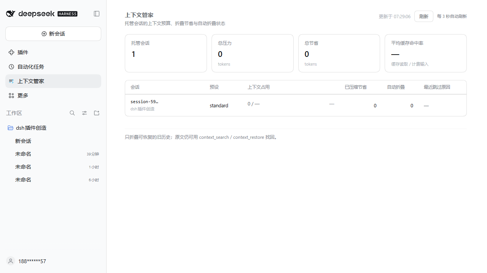

# dsh-context-keeper（上下文管家）

[English](README.en.md) ｜ 中文

[](https://github.com/YansongG-HKU/dsh-context-keeper/actions/workflows/ci.yml)
[](LICENSE)

DeepSeek Harness 原生插件：让**长会话真正省 token**，同时**不把模型变笨**。

不是代理、不改请求、不碰模型 API。它作为 Host 插件挂在每个顶层会话里，用 DSH 自己的会话日志、token 计量和压缩事务工作：

- **看得见**：`context_status` 告诉你当前上下文预算、构成、最占 token 的历史条目、已压缩节省量、缓存命中率。
- **找得回**：`context_search` 在**完整会话日志**里检索，包括已经被压缩隐藏的历史；`context_restore` 按序号取回原文。压缩≠删除。
- **折得动**：`context_compact` 由模型自己决定折叠哪段旧历史；`dry_run` 先看计划。
- **自动省**：压力超过阈值时，在每步开始前把最旧的、工具调用配对完整的一段折叠成摘要，保留最近 3 万 token 原文；原生 80% 压缩仍然是兜底。

## 为什么是"借鉴 + 原生适配"

| billion-context 的优点 | 本插件怎么吸收 | 为什么更适合 DSH |
| --- | --- | --- |
| 模型自己决定何时/折叠什么 | `context_compact` + `context_status` 工具 | 不用注入代理工具、不重写请求流，走原生会话事务 |
| 增量、分层压缩（多代摘要） | 自动策略每次只折最旧一段；下一次折叠会把上一代摘要作为头部再合并 | 复用 `compaction/*` 事件协议，UI/回放/持久化自动兼容 |
| 可逆（decompress） | `context_search` + `context_restore` 读原始事件 | DSH 本来就把被替换的原始事件保留在日志里，插件只是把"取回"暴露给模型 |
| 可搜索（search_context） | `context_search` 覆盖可见、已压缩、摘要三类行 | 直接读 append-only 日志，不需要独立索引/存储 |
| 前缀缓存友好 | 摘要调用回放**同一份** system + tools + 区间消息，压缩指令只追加在末尾 | 与官方 `dsh-compaction-basic` 完全同构，复用提供方热前缀 |
| 用量/压缩状态可见 | `context_status.usage`、`.compaction` | 读 DSH 自己的 token meter 与会话日志，不另建账本 |

DSH 已经自带的省 token 机制**不重复造**：自动压缩（`dsh-compaction-basic`）、超大工具结果剪枝（`dsh-compaction-tool-result-pruner`，8 KiB）、spill 到文件（`dsh-spill-policy`）、token 计量（`dsh-token-meter`）、技能按需加载。本插件只补它们缺的部分：**模型可自主折叠 + 折叠后可检索/可恢复 + 更早的增量折叠**。

## 安装后模型看到什么

四个工具，固定在每次请求的 schema 里，合计约 **755 tokens**（按 4 字符/token 粗估）。不需要时可在配置里逐个关掉。

```jsonc
{
  "tools": { "status": true, "search": true, "restore": true, "compact": true },
  "autoCompact": {
    "enabled": true,
    "minPressureRatio": 0.6,   // 达到上下文窗口的 60% 才自动折叠
    "retainTokens": 30000,     // 最近 3 万 token 原文保留
    "minFoldTokens": 8000,     // 太小的一段不值得折叠
    "minGrowthTokens": 20000,  // 两次折叠之间至少增长这么多
    "maxFoldsPerTurn": 2
  },
  "includeSubagents": false,
  "promptSection": false,
  "search": { "limit": 10, "snippetChars": 240 },
  "restore": { "maxTokens": 6000 },
  "debug": false
}
```

在 profile 的 `cordis.patch.yml` 里按行 id 覆盖配置（`install_bundle` 会插入这一行，patch 里写同 id 即覆盖）：

```yaml
- id: dsh-context-keeper
  config:
    autoCompact:
      enabled: true
      minPressureRatio: 0.6
```

想完全关掉自动折叠、只留工具：

```yaml
- id: dsh-context-keeper
  config:
    autoCompact: { enabled: false }
```

## 为什么"不降智"

1. **不删日志**：折叠写入 `compaction/start → compaction/summary → user/message(replace) → compaction/end`，原始事件仍在 session log，回放、搜索、恢复都还在。
2. **摘要用官方 checkpoint 提示词**：沿用 `dsh-compaction-basic` 的八段式结构化摘要指令与 `<compacted-summary>` 框定，模型看到的是它本来就被训练接受过的检查点形态。
3. **保留近期原文**：默认最近 3 万 token 一字不改，正在做的事不会丢。
4. **自动折叠有门槛**：默认窗口 60% 以下不动；两次折叠之间要求有 2 万 token 增长；每轮最多 2 次。
5. **原生 80% 压缩兜底**：本插件只"更早、更小段"地折叠，不替换官方后端；官方后端仍按自己的阈值工作。
6. **摘要必须比原文更小**：写盘前校验 framed 摘要 token < 被替换区间 token，否则事务回滚（记录 `compaction/end.error`）。
7. **需要细节随时取回**：`context_search` → 命中 seq → `context_restore` 读原文，模型可以自己把丢掉的细节找回来。

## 实测数据（真实会话）

**2026-11-04 最新复测**（完整报告：[`docs/benchmarks.md`](docs/benchmarks.md)）：

- 当前实时会话：压力 454,619（窗口 1,048,576，43.4%）；`context_compact --dry-run` 实测折一次 = 489 节点 / **325,988 tokens**，压力 **455,577 → ≈13 万（-71.5%）**，之后每步少付 ≈32.6 万 tokens。
- 真实长会话 `session-a74…`（240 步，累计账单 90,156,133 tokens，缓存命中 99.63%）：保留 3 万原文折 **549 节点 / 403,901 tokens**，压力 466,617 → 62,817（**-86.5%**）；保留 10 万折 424 节点 / 334,040 tokens，**-71.6%**。
- **策略仿真**（真实账单轨迹）：默认阈值 0.60 在 1M 窗口下实际 **0 次触发**（真实峰值 59 万/72.7 万 < 63 万）；调 `minPressureRatio: 0.45` → 240 步会话省 **33.6%**、668 步会话省 **53.2%**；调 0.35 → **44.5% / 72.8%**。
- 金额口径：DeepSeek cache hit = miss 的 1/50，token 口径 <1 步回本，**金额约 8～25 步回本**（折得越狠回本越快）。

`context_status` 在真实会话（`session-a74…`，preset `ptc`，窗口 1,048,576）中的返回（节选，早期读数）：

```json
{"budget":{"model":"deepseek-flash","contextWindow":1048576,"pressureTokens":344722,"usedRatio":0.329},
 "usage":{"steps":91,"billedInputTokens":19767888,"cacheReadTokens":19551360,"cacheHitRatio":0.989}}
```

- 早期基线：最近 10 步平均 billed input **417,416 tokens/步**，缓存命中 **99.90%**。
- 早期重放折叠：183 个节点 / **215,589 tokens** 被折叠，压力 **350,794 → 135,306**；每个后续请求少付 ≈ **215,488 tokens**。
- 旧口径折算：每步省 ≈ $0.00065；一次性重缓存 + 摘要调用 ≈ $0.026，**约 40 步回本**（此为 21.5 万 token 折叠的旧估计；2026-11-04 复测中折得更多的方案约 8～25 步）。
- 与成熟方案的口径对齐对比见 [`docs/competitive-landscape.md`](docs/competitive-landscape.md)。

## Web 面板（左侧栏 → 上下文管家）



- 左侧栏入口 **「上下文管家 / Context Keeper」** + 主面板（参考 superagent 面板，功能优先、不花哨）：
  - 顶部：托管会话数、总压力 tokens、总节省 tokens、平均缓存命中率；
  - 会话表：短 id、preset、上下文占用（压力/窗口 + 百分比 + 进度条）、已压缩节省、自动折叠次数、最近一次跳过原因；
  - 每 3 秒自动刷新 + 手动刷新；空态与错误态都有明确文案。
- 数据来自 Host 同源路由 `GET /context-keeper/api/state`（loopback + `x-context-keeper: 1` 请求头 + Origin 校验），面板只读，不会触发折叠。
- 客户端代码 `client.js`（手写浏览器插件产物，注册 `sidebar.panellist` 与 `main` 槽）；Host 路由 `lib/panel.js`。
- 折叠统计只计入**真正落地**的事务：摘要写了但替换没落地的失败事务（例如协议不匹配的那次）不会被算进"已节省"。

含义：该会话每轮实际账单输入 ≈ 1980 万 token 中 98.9% 是缓存命中；一旦把 28 万可折叠历史压成 8k 摘要，后续每轮请求压力从 34 万降到 5 万以内，**缓存命中部分按折后规模计费**，这才是真节省。自动折叠在 1M 窗口下要等到 ~63 万才触发（`minPressureRatio 0.6`），所以默认场景里更多是模型在需要时主动用 `context_compact`。

## 文件与实现

```
index.js               Host 插件入口：装饰每个顶层 Agent（agent/created + 已存在的 Agent），并注册 Web 面板路由
lib/config.js          配置解析/校验（未知键报错，坏值拒绝加载）
lib/events.js          会话日志纯函数：文本提取、搜索、取回、用量/压缩统计（只计落地事务）
lib/context.js         预算状态、折叠范围选择（保留尾部 + 工具调用配对边界 + 跳过 system head）
lib/compaction.js      原生压缩事务：写前校验 v4 会话规则；优先用 ctx.compaction，访问不到时按同协议自行完成
lib/tools.js           四个模型工具定义（纯 JSON Schema，不 import 任何 DSH 包）
lib/auto.js            增量自动折叠策略
lib/panel.js           Host 面板路由：/context-keeper/api/state（loopback + 同源头校验）
client.js              Web 客户端：左侧栏图标 + 主面板（手写浏览器插件产物）
test/*.test.mjs        纯函数 + 真实 DSH Session + 假服务 + 插件/面板接线测试
test/runtime-format.test.mjs  回归：插件事务后的日志必须通过真实 v4 加载校验（防"历史加载失败"）
test/verify-live-log.mjs  用真实会话日志重放验证协议与折叠事务
test/billing-analysis.mjs 逐 step 账单基线统计
test/vendor/           测试用的 @deepseek-ai/dsh-session 0.2.1-rc.5（与桌面版 DSH 完全同版本）
```

设计要点：`agent.ctx.tools.register()` 把工具注册进**该 Agent 自己的作用域**，因此不影响子代理、不污染全局工具表；折叠优先走 `ctx.compaction.compactRegion()`，只有当前 preset 的压缩服务被隔离（stock Web/Desktop 就是这样）时才落到同协议的自有事务。

## 测试与验证

```powershell
git clone https://github.com/YansongG-HKU/dsh-context-keeper
cd dsh-context-keeper
npm test                    # 离线可跑：测试依赖已 vendored（DSH 0.2.1-rc.5 同版本）
# 用真实会话日志重放验证协议 + 折叠事务（传入逐帧 zstd 解码后的 session JSONL）
node test/verify-live-log.mjs <path-to-decoded-session.jsonl>
```

当前：**48/48 通过**。覆盖：配置校验、事件文本/搜索/取回、真实 Session 的 system head / 平衡边界 / 折叠范围、真压缩后的隐藏与恢复、四个工具的成功/失败路径、自有事务的完整事件协议与"摘要不更小"回滚、失败事务不计入节省、自动策略的阈值/增长/每轮上限/中止、插件接线与子代理跳过、Web 面板槽注册/数据/路由同源校验；以及 **4 条 v4 加载回归**（`test/runtime-format.test.mjs`）：事务后日志必须通过真实 v4 格式校验与 `Session.create` 回放、含 system 头的折叠范围在写盘前被拒绝、加载器确实拒绝"summary 覆盖 system 头"的故障形态、checkpoint 消息 source 必须是 `compact-checkpoint`。

**协议一致性（2026-11-04 更正）**：桌面版 DSH 0.2.1-rc.5 的会话格式是 **v4**：`dsh-session` 0.2.1-rc.5（app.asar 内 `dsh-desktop` 与 `dsh-session` 均已核实为 0.2.1-rc.5），`system/message` 是 **surface 节点 0**（但它的 log seq 不一定是 0——真实会话里前面可以有 `request/context`、`turn/start` 等 log-only 事件，例如 `session-a74…` 的 system 头在 **seq 15**），替换标记为 `{op:'replace', startSeq, endSeq}`（恰好三个键），`request/header` 不带 system。测试依赖曾经错误地固定在 `0.2.2-alpha.3`（npm 上较新的线），现已改为从**与桌面版完全同版本的 0.2.1-rc.5 完整依赖树离线 vendored**（见 `test/vendor/`），与桌面运行时**完全同版本**。

v4 加载器会在**每次打开会话时重放** `compaction/summary` 的 `shadowedRange` + `shadowedSeqs`：必须是当时 surface 上精确的一段、且**不能包含受保护的 system 头**；`user/message` 的 `source.kind` 必须是"生产者自有的"（例如 `compact-checkpoint`），**`kind:'plugin'` 已被废弃**。违反任一条，整个会话日志会被判为非法 → UI 显示「历史加载失败」。本插件现在在写 summary 之前用 `assertFoldSpan()` 做这两项校验，checkpoint 消息 source 用 `{kind:'compact-checkpoint', compactionId}`，并有回归测试用真实 v4 加载器验证事务后的日志可加载。

**故障修复记录（2026-11-04，真实事故）**：早期版本在一次 240 步真实会话上执行折叠时，选段把 **seq 15 的 system 头**包含进了 `shadowedRange {15..639}`；替换消息因 `invalid replace surfaceOp` 没落地，但**这条 summary 单独存在就足以让该会话永久无法加载**（`SessionFormatError: compaction cannot shadow the protected system head`，UI 显示「历史加载失败」）。修复分两步：① 对受影响的会话日志做最小修复（只把该条 abandoned summary 的声明范围收窄为 `{16..639}`，**不改 seq 编号、不删任何事件**），并用真实 0.2.1-rc.5 引擎验证 `Session.create` 回放与 v4 格式校验均通过；② 插件自身在写 summary 前做 `assertFoldSpan()` 校验 + checkpoint source 合法化，并补了 4 条 v4 加载回归测试（见 `test/runtime-format.test.mjs`）。这个事故也是本仓库「对日志做写前校验」设计的由来。

## 安装（DSH Web/Desktop profile）

前提：DSH 0.2.1-rc.5 或更新（会话格式 v4）；Node.js ≥ 22（仅测试需要）。

```powershell
git clone https://github.com/YansongG-HKU/dsh-context-keeper
# 方式 A：让 DSH 的 plugin_manager 安装（推荐）
#   install_bundle target = <本仓库目录>
# 方式 B：手工把 bundle 加进 profile（等价于 plugin_manager 做的事）
#   1) profile package.json 的 dsh.profile.bundles 追加 "dsh-context-keeper"
#   2) profile 的 node_modules 建 junction/symlink 指向本仓库目录
#   3) 重启 DSH 桌面进程（Host JS 模块在进程内缓存、Client 模块启动时组网）
```

安装后：4 个工具立即进入**该 Agent 自己的工具作用域**（不影响子代理），左侧栏出现「上下文管家」面板；配置改动走 profile patch 热加载，代码改动需要重启 DSH。

```yaml
# profile 的 cordis.patch.yml：覆盖插件配置（同 id 覆盖 bundle 默认值）
- id: dsh-context-keeper
  config:
    autoCompact:
      enabled: true
      minPressureRatio: 0.45   # 1M 窗口建议 0.35–0.45；默认 0.6 偏保守
      retainTokens: 30000
```

## 已知限制

- 自有压缩事务与官方 backend 同协议、同摘要提示词，但**代码独立**；DSH 升级后请重跑测试。
- 默认不装饰子代理会话（避免给子任务增加工具开销）；需要时 `includeSubagents: true`。
- 4 个工具 schema 固定约 755 tokens；不用的工具建议在配置里关掉。
- 自动折叠默认阈值对 1M 窗口偏保守；想更省可把 `minPressureRatio` 调到 0.35–0.45，代价是更早折叠（细节仍可用 `context_restore` 找回）。
- 没有公开基准（benchmark）成绩：`docs/benchmarks.md` 里的是**本地真实会话重放/仿真**，不是线上生产 A/B，也不是与竞品同口径的跑分。

## License

MIT，见 [LICENSE](LICENSE)。摘要提示词沿用 DSH 官方 `dsh-compaction-basic`（MIT）；`test/vendor/` 内 vendored 的测试依赖均为各自 MIT 许可，见 [test/vendor/README.md](test/vendor/README.md)。


